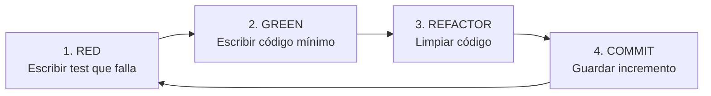

# Guía de Estudio y Defensa Técnica Exhaustiva - Práctica 3 MADS
## Integración Continua con GitHub Actions y Desarrollo Guiado por Pruebas (TDD)

**Autor:** Iván Lafont  
**Asignatura:** Metodologías Ágiles de Desarrollo de Software (MADS)  
**Versión de la Entrega:** 1.2.0  
**Repositorio:** `mads-todolist-ilj8-ua`  

---

## Tabla de Contenidos
1. [Introducción y Objetivos Globales de la Práctica](#1-introducción-y-objetivos-globales-de-la-práctica)
2. [Integración Continua con GitHub Actions](#2-integración-continua-con-github-actions)
   * [2.1 ¿Qué es Integración Continua (CI)?](#21-qué-es-integración-continua-ci)
   * [2.2 Workflow 1: Developer Tests (`developer-tests.yml`)](#22-workflow-1-developer-tests-developer-testsyml)
   * [2.3 Workflow 2: Integration Tests con Docker Postgres (`integration-tests.yml`)](#23-workflow-2-integration-tests-con-docker-postgres-integration-testsyml)
   * [2.4 ¿Por qué mantener ambos Workflows?](#24-por-qué-mantener-ambos-workflows)
3. [Perfiles de Spring Boot, Docker y PostgreSQL](#3-perfiles-de-spring-boot-docker-y-postgresql)
   * [3.1 El sistema de perfiles de Spring Boot](#31-el-sistema-de-perfiles-de-spring-boot)
   * [3.2 ¿Por qué dos bases de datos: `mads` y `mads_test`?](#32-por-qué-dos-bases-de-datos-mads-y-mads_test)
   * [3.3 Comandos Docker fundamentales](#33-comandos-docker-fundamentales)
   * [3.4 Cómo lanzar la aplicación y los tests con perfil postgres](#34-cómo-lanzar-la-aplicación-y-los-tests-con-perfil-postgres)
4. [La Metodología TDD (Test-Driven Development)](#4-la-metodología-tdd-test-driven-development)
   * [4.1 Ciclo Red-Green-Refactor](#41-ciclo-red-green-refactor)
   * [4.2 La regla de "Baby Steps" y commits modulares](#42-la-regla-de-baby-steps-y-commits-modulares)
   * [4.3 La regla de los Controllers limpios](#43-la-regla-de-los-controllers-limpios)
   * [4.4 El uso de `@Transactional` (Dónde sí y dónde no)](#44-el-uso-de-transactional-dónde-sí-y-dónde-no)
5. [Historia 008: Listado de Equipos (TDD Paso a Paso)](#5-historia-008-listado-de-equipos-tdd-paso-a-paso)
   * [5.1 Los 10 Tests TDD explicados con código](#51-los-10-tests-tdd-explicados-con-código)
   * [5.2 Capa de Vista y Controller de la Historia 008](#52-capa-de-vista-y-controller-de-la-historia-008)
6. [Historia 009: Gestionar Pertenencia al Equipo (TDD Paso a Paso)](#6-historia-009-gestionar-pertenencia-al-equipo-tdd-paso-a-paso)
   * [6.1 El problema de la desvinculación en relaciones `@ManyToMany`](#61-el-problema-de-la-desvinculación-en-relaciones-manytomany)
   * [6.2 Los 10 Tests TDD explicados con código](#62-los-10-tests-tdd-explicados-con-código)
   * [6.3 Capa de Vista y Controller de la Historia 009](#63-capa-de-vista-y-controller-de-la-historia-009)
7. [Historia 010: Gestión de Equipos - Administrador (TDD Paso a Paso)](#7-historia-010-gestión-de-equipos---administrador-tdd-paso-a-paso)
   * [7.1 El reto de la eliminación segura de equipos](#71-el-reto-de-la-eliminación-segura-de-equipos)
   * [7.2 Los 10 Tests TDD explicados con código](#72-los-10-tests-tdd-explicados-con-código)
   * [7.3 Seguridad y Capa de Vista/Controller de la Historia 010](#73-seguridad-y-capa-de-vistacontroller-de-la-historia-010)
8. [Patrones y Mecanismos Internos de Spring Boot e Hibernate](#8-patrones-y-mecanismos-internos-de-spring-boot-e-hibernate)
9. [Batería de Preguntas de Examen / Defensa Oral con Respuestas](#9-batería-de-preguntas-de-examen--defensa-oral-con-respuestas)

---

## 1. Introducción y Objetivos Globales de la Práctica

Esta tercera práctica representa un salto cualitativo respecto a las prácticas 1 y 2. Ya no se trata solo de construir pantallas o endpoints web, sino de aplicar **ingeniería de software ágil profesional**.

Los tres grandes pilares de la práctica son:
1. **Integración Continua (CI) en GitHub Actions:** Automatizar la compilación y ejecución de tests en la nube ante cualquier cambio en el repositorio, usando máquinas virtuales y contenedores Docker para aislar el entorno.
2. **Uso de múltiples entornos de base de datos:** Dejar de depender únicamente de una base de datos volátil en memoria (H2) y configurar perfiles de Spring Boot para trabajar contra un motor relacional real en producción (**PostgreSQL 13**), tanto en local mediante contenedores Docker como en la integración continua.
3. **Desarrollo Guiado por Pruebas (TDD):** Implementar una nueva funcionalidad de negocio completa (**Gestión de Equipos y Miembros**) aplicando de forma rigurosa la técnica de **escribir primero el test que falla y después el código mínimo necesario**.

### Estado final del proyecto
* **Versión oficial:** `1.2.0` (etiquetada en Git con el tag `v1.2.0`).
* **Batería de pruebas:** **114 tests automatizados**, pasando al 100% (cero fallos, cero errores).
* **Estructura Git:** Dos issues por historia de usuario (Servicio/Modelo e Interfaz/Controller), desarrolladas en sus ramas de características (`servicio-*` y `vista-*`) y fusionadas a `main` mediante Pull Requests.

---

## 2. Integración Continua con GitHub Actions

### 2.1 ¿Qué es Integración Continua (CI)?
Es la práctica de desarrollo software en la que los miembros de un equipo integran su trabajo de manera frecuente (al menos diariamente). Cada integración es verificada por un sistema automatizado que compila el código y ejecuta los tests. Si alguien introduce un error que rompe la aplicación, el sistema avisa de inmediato antes de que el código defectuoso llegue a la rama principal (`main`) o a producción.

En GitHub, esto se implementa mediante **GitHub Actions**, definiendo archivos en formato YAML dentro del directorio `.github/workflows/`.

---

### 2.2 Workflow 1: Developer Tests (`developer-tests.yml`)

Este flujo de trabajo representa las pruebas rápidas del desarrollador sobre base de datos H2 en memoria.

```yaml
name: Developer tests

on: push

jobs:
  launch-tests:
    runs-on: ubuntu-latest
    container: openjdk:8-jdk-alpine
    steps:
      - uses: actions/checkout@v2
      - name: Launch tests with Maven
        run: ./mvnw test
```

#### Explicación línea a línea:
* `name: Developer tests`: Nombre legible que aparece en la pestaña *Actions* de GitHub.
* `on: push`: Evento desencadenante. Se ejecuta automáticamente cada vez que se sube un commit a cualquier rama o Pull Request.
* `jobs:`: Define las tareas que componen el flujo de trabajo.
* `runs-on: ubuntu-latest`: La máquina virtual base que GitHub aprovisiona temporalmente en la nube.
* `container: openjdk:8-jdk-alpine`: En lugar de ejecutar en la máquina host, GitHub descarga una imagen Docker ligera de Linux Alpine con Java 8 instalado para ejecutar ahí los comandos.
* `uses: actions/checkout@v2`: Acción predefinida de GitHub que clona nuestro repositorio en el contenedor para que podamos compilarlo.
* `run: ./mvnw test`: Ejecuta el wrapper de Maven lanzando la suite de tests por defecto (con el perfil `dev` y BD H2 en memoria).

---

### 2.3 Workflow 2: Integration Tests con Docker Postgres (`integration-tests.yml`)

Este flujo representa los tests de integración en un entorno idéntico a producción.

```yaml
name: Integration tests

on: push

jobs:
  container-job:
    runs-on: ubuntu-latest
    container: openjdk:8-jdk-alpine

    services:
      postgres:
        image: postgres:13
        env:
          POSTGRES_USER: mads
          POSTGRES_PASSWORD: mads
          POSTGRES_DB: mads_test
        options: >-
          --health-cmd pg_isready
          --health-interval 10s
          --health-timeout 5s
          --health-retries 5

    steps:
      - uses: actions/checkout@v2
      - name: Launch tests with Maven
        run: ./mvnw test -D spring.profiles.active=postgres
        env:
          POSTGRES_HOST: postgres
```

#### Puntos técnicos clave:
1. **Directiva `services:`**: Permite levantar servicios auxiliares en red dentro de la misma máquina virtual. En nuestro caso, arranca un contenedor Docker con la imagen oficial de `postgres:13`.
2. **Variables de entorno del contenedor PostgreSQL**:
   * `POSTGRES_USER: mads`: Usuario administrador del motor PostgreSQL.
   * `POSTGRES_PASSWORD: mads`: Contraseña.
   * `POSTGRES_DB: mads_test`: Nombre de la base de datos creada al arrancar.
3. **Health-Check (`options: --health-cmd pg_isready`)**: PostgreSQL tarda unos segundos en arrancar e inicializar sus procesos. Si Maven intentase conectar de inmediato, los tests fallarían con `ConnectionRefused`. La opción `pg_isready` comprueba activamente que el motor esté aceptando conexiones antes de continuar.
4. **Activación del perfil y resolución de host**:
   * `./mvnw test -D spring.profiles.active=postgres`: Le dice a Spring Boot que cargue `application-postgres.properties`.
   * `POSTGRES_HOST: postgres`: En la red interna de Docker creada por GitHub Actions, el contenedor del servicio PostgreSQL es accesible mediante el nombre de su servicio (`postgres`).

---

### 2.4 ¿Por qué mantener ambos Workflows?
* **Velocidad vs. Realismo:** Los developer tests tardan apenas 30 segundos porque H2 funciona en la memoria RAM del proceso Java. Los integration tests tardan algo más (deben descargar la imagen Docker de PostgreSQL, esperar al health-check y realizar I/O en disco), pero garantizan que no haya diferencias de sintaxis SQL o tipos de datos entre H2 y PostgreSQL.
* **Comprobación de fallos:** Durante la práctica se realizó la prueba requerida de introducir un fallo deliberado en un test, comprobar cómo el Pull Request se bloqueaba con una cruz roja (`X`), y verificar que solo tras corregir el código y volver a subirlo se ponía en verde (`✓`) permitiendo el merge.

---

## 3. Perfiles de Spring Boot, Docker y PostgreSQL

### 3.1 El sistema de perfiles de Spring Boot

En Spring Boot, los perfiles permiten separar la configuración según el entorno (desarrollo, testing, producción) sin modificar el código Java.

La jerarquía de ficheros en el proyecto es:
```text
src/
├── main/
│   └── resources/
│       ├── application.properties             (Perfil base/por defecto: dev con H2)
│       └── application-postgres.properties    (Perfil postgres para EJECUCIÓN: BD mads)
└── test/
    └── resources/
        ├── application.properties             (Perfil base de test con H2)
        └── application-postgres.properties    (Perfil postgres para TEST: BD mads_test)
```

En `src/main/resources/application.properties` se indica el perfil activo por defecto:
```properties
spring.profiles.active=dev
```

Cuando pasamos a la línea de comandos `-D spring.profiles.active=postgres`, Spring Boot busca automáticamente los ficheros con el sufijo `-postgres.properties` y sobreescribe las propiedades de conexión.

---

### 3.2 ¿Por qué dos bases de datos: `mads` y `mads_test`?

Este es uno de los detalles de diseño más importantes:
* En `src/main/resources/application-postgres.properties` conectamos con:
  `jdbc:postgresql://localhost:5432/mads`
* En `src/test/resources/application-postgres.properties` conectamos con:
  `jdbc:postgresql://${POSTGRES_HOST}:${POSTGRES_PORT}/mads_test`

**Razón fundamental:**  
Cuando se ejecutan los tests de integración, Hibernate tiene configurado `ddl-auto=create`, lo que significa que **borra y recrea las tablas**, y además se ejecuta el script `clean-db.sql` que hace `DELETE FROM ...`.  
Si los tests usaran la base de datos `mads`, cada vez que ejecutases `./mvnw test` se borrarían todos los datos que habías introducido a mano en la aplicación web para probarla. Al usar `mads_test`, la suite de pruebas tiene su propio espacio aislado y nunca destruye los datos de desarrollo.

---

### 3.3 Comandos Docker fundamentales

Para trabajar en local con PostgreSQL sin tener que instalarlo en el sistema operativo usamos Docker:

1. **Crear y arrancar el contenedor de desarrollo (`mads`):**
   ```bash
   docker run -d -p 5432:5432 --name postgres-develop \
     -e POSTGRES_USER=mads \
     -e POSTGRES_PASSWORD=mads \
     -e POSTGRES_DB=mads \
     postgres:13
   ```
   * `-d`: Modo *detached* (en segundo plano).
   * `-p 5432:5432`: Mapea el puerto 5432 del contenedor al puerto 5432 de nuestra máquina física.
   * `--name postgres-develop`: Asigna un nombre descriptivo al contenedor.
   * `-e VAR=VAL`: Inyecta las variables de entorno necesarias para la imagen.

2. **Crear y arrancar el contenedor de pruebas locales (`mads_test`):**
   ```bash
   docker run -d -p 5432:5432 --name postgres-test \
     -e POSTGRES_USER=mads \
     -e POSTGRES_PASSWORD=mads \
     -e POSTGRES_DB=mads_test \
     postgres:13
   ```

3. **Gestión de contenedores:**
   * `docker container ls -a`: Lista todos los contenedores y su estado.
   * `docker container stop postgres-develop`: Detiene el contenedor (los datos persisten en el volumen).
   * `docker container start postgres-develop`: Reanuda el contenedor conservando todos los datos previos.
   * `docker container logs postgres-develop`: Muestra los logs de la base de datos para diagnosticar errores.

---

### 3.4 Cómo lanzar la aplicación y los tests con perfil postgres

* **Arrancar la aplicación conectada a Postgres:**
  ```bash
  ./mvnw spring-boot:run -Dspring-boot.run.profiles=postgres
  ```
* **Lanzar la suite de tests contra Postgres local:**
  ```bash
  ./mvnw -D spring.profiles.active=postgres test
  ```
* **Empaquetar y ejecutar el `.jar` directamente:**
  ```bash
  ./mvnw package -DskipTests
  java -Dspring.profiles.active=postgres -jar target/mads-todolist-0.0.1-SNAPSHOT.jar
  ```

---

## 4. La Metodología TDD (Test-Driven Development)

### 4.1 Ciclo Red-Green-Refactor

TDD no consiste simplemente en "tener muchos tests". Es una disciplina de **diseño de software** donde los tests actúan como especificación viva de requisitos:



1. **Fase Roja (Red):** Diseñas la interfaz de uso antes de que exista la implementación. El test describe qué entrada recibe la función y qué salida se espera. Al ejecutar el test, **falla** (o ni compila).
2. **Fase Verde (Green):** Escribes el código **mínimo estrictamente necesario** para que el test pase. Está explícitamente prohibido escribir lógica adicional que no esté exigida por el test actual.
3. **Fase de Refactorización (Refactor):** Una vez que el test está verde, mejoras la legibilidad, eliminas duplicidades o extraes métodos. Como tienes la red de seguridad del test, sabes al instante si rompes algo.
4. **Commit:** Registras el cambio en Git de forma independiente.

---

### 4.2 La regla de "Baby Steps" y commits modulares

Uno de los requisitos más vigilados por los evaluadores en MADS es la **modularidad de los commits**:
* Cada commit debe contener entre **15 y 25 líneas de código de producción** (sin contar el test).
* Por cada test superado se realiza un commit individual con un mensaje claro (`Test 1 - ...`, `Test 2 - ...`).
* Esto demuestra que no se programó toda la clase de golpe y luego se escribieron los tests para rellenar, sino que el diseño fue guiado paso a paso.

---

### 4.3 La regla de los Controllers limpios

En una arquitectura limpia, **la lógica de negocio NUNCA reside en los Controllers**:
* Los controladores solo se ocupan del protocolo HTTP:
  1. Comprobar autenticación y sesión (`comprobarUsuarioLogeado()`).
  2. Extraer parámetros del formulario o de la URL (`@PathVariable`, `@ModelAttribute`).
  3. Delegar la operación en el método correspondiente de la capa de servicio (`equipoService.crearEquipo(...)`).
  4. Capturar posibles excepciones de negocio (`EquipoServiceException`) para devolver mensajes amigables al usuario.
  5. Decidir qué vista mostrar (`return "formEditarEquipo"`) o qué redirección aplicar (`return "redirect:/equipos"`).
* Toda validación (nombres vacíos, duplicados, permisos de pertenencia) vive en el **Service**, lo cual permite reutilizarla desde cualquier cliente (web, API REST, tareas programadas) y testearla unitariamente al 100%.

---

### 4.4 El uso de `@Transactional` (Dónde sí y dónde no)

* **En la capa de servicio (`EquipoService.java`):**
  * Todos los métodos públicos llevan `@Transactional`.
  * Los métodos de solo lectura llevan `@Transactional(readOnly = true)`. Esto optimiza enormemente Hibernate porque desactiva el mecanismo de comprobación de modificaciones en memoria (*dirty checking*) y utiliza conexiones de solo lectura en el pool.
* **En los tests de repositorio (`EquipoTest.java`):**
  * Llevan `@Transactional` para que la transacción permanezca abierta durante el test y Hibernate realice un *rollback* automático al finalizar cada método, manteniendo limpia la BD.
* **En los tests de servicio (`EquipoServiceTest.java`):**
  * **¡NO llevan `@Transactional` en la clase!** Esto es crucial: queremos que el test ejecute los métodos del servicio exactamente igual que lo haría un controlador web real. Si pusiéramos `@Transactional` a nivel de test, ocultaríamos errores como la carga perezosa fuera de sesión (*LazyInitializationException*) o transacciones mal delimitadas.

---

## 5. Historia 008: Listado de Equipos (TDD Paso a Paso)

**Historia de usuario:**  
*Como usuario podré consultar el listado de los equipos existentes y los participantes en cada uno de ellos para poder consultar la estructura de la empresa y los proyectos en marcha y comprobar si estoy en los equipos correctos.*

---

### 5.1 Los 10 Tests TDD explicados con código

#### Test 1: Clase `Equipo` básica (POJO)
* **Objetivo:** Crear la entidad `Equipo` como simple clase Java con atributo `nombre`, constructor y getter.
* **Test:**
  ```java
  @Test
  public void crearEquipo() {
      Equipo equipo = new Equipo("Proyecto P1");
      assertThat(equipo.getNombre()).isEqualTo("Proyecto P1");
  }
  ```
* **Solución mínima:** Clase `Equipo` con campo `private String nombre`, constructor con parámetro y getter `getNombre()`.

---

#### Test 2: Persistencia JPA y repositorio
* **Objetivo:** Convertir `Equipo` en una entidad gestionada por JPA y guardarla en la tabla `equipos`.
* **Test:**
  ```java
  @Test
  @Transactional
  public void grabarYBuscarEquipo() {
      Equipo equipo = new Equipo("Proyecto P1");
      equipoRepository.save(equipo);
      Long equipoId = equipo.getId();
      assertThat(equipoId).isNotNull();
      Equipo equipoDB = equipoRepository.findById(equipoId).orElse(null);
      assertThat(equipoDB).isNotNull();
      assertThat(equipoDB.getNombre()).isEqualTo("Proyecto P1");
  }
  ```
* **Solución mínima:** Añadir anotaciones `@Entity`, `@Table(name = "equipos")`, clave primaria `@Id @GeneratedValue(strategy = GenerationType.IDENTITY) private Long id;`, constructor vacío por defecto para Hibernate, y crear la interfaz `EquipoRepository extends CrudRepository<Equipo, Long>`. Actualizar `clean-db.sql` con `DELETE FROM equipos;`.

---

#### Test 3: Definición de igualdad (`equals` y `hashCode`)
* **Objetivo:** Definir cómo se comparan dos equipos (por nombre si no tienen ID asignado; por ID si ambos lo tienen).
* **Test:**
  ```java
  @Test
  public void comprobarIgualdadEquipos() {
      Equipo equipo1 = new Equipo("Proyecto P1");
      Equipo equipo2 = new Equipo("Proyecto P2");
      Equipo equipo3 = new Equipo("Proyecto P2");
      assertThat(equipo1).isNotEqualTo(equipo2);
      assertThat(equipo2).isEqualTo(equipo3);

      equipo1.setId(1L);
      equipo2.setId(1L);
      equipo3.setId(2L);
      assertThat(equipo1).isEqualTo(equipo2);
      assertThat(equipo2).isNotEqualTo(equipo3);
  }
  ```
* **Solución mínima:** Implementar `equals()` y `hashCode()` en `Equipo.java` comprobando primero si `id != null && equipo.id != null` para comparar por identificador, o por `nombre.equals(...)` en caso contrario.

---

#### Test 4: Relación `@ManyToMany` entre Equipos y Usuarios
* **Objetivo:** Conectar equipos con usuarios de forma que un equipo tenga muchos usuarios y un usuario pertenezca a muchos equipos.
* **Test:**
  ```java
  @Test
  @Transactional
  public void comprobarRelacionBaseDatos() {
      Equipo equipo = new Equipo("Proyecto 1");
      equipoRepository.save(equipo);
      Usuario usuario = new Usuario("user@ua");
      usuarioRepository.save(usuario);

      equipo.addUsuario(usuario);

      Equipo equipoBD = equipoRepository.findById(equipo.getId()).orElse(null);
      Usuario usuarioBD = usuarioRepository.findById(usuario.getId()).orElse(null);
      assertThat(equipo.getUsuarios()).contains(usuario);
      assertThat(usuario.getEquipos()).contains(equipo);
  }
  ```
* **Solución técnica en `Equipo.java`:**
  ```java
  @ManyToMany(fetch = FetchType.LAZY)
  @JoinTable(name = "equipo_usuario",
          joinColumns = { @JoinColumn(name = "fk_equipo") },
          inverseJoinColumns = { @JoinColumn(name = "fk_usuario") })
  Set<Usuario> usuarios = new HashSet<>();

  public void addUsuario(Usuario usuario) {
      this.getUsuarios().add(usuario);
      usuario.getEquipos().add(this); // Sincronización bidireccional
  }
  ```
* **En `Usuario.java`:**
  ```java
  @ManyToMany(mappedBy = "usuarios")
  Set<Equipo> equipos = new HashSet<>();
  ```
* **Actualización en `clean-db.sql`:**
  `DELETE FROM equipo_usuario; DELETE FROM tareas; DELETE FROM equipos; DELETE FROM usuarios;`

---

#### Test 5: Listado en Repositorio (`findAll`)
* **Objetivo:** Recuperar todos los equipos de la base de datos como una `List<Equipo>`.
* **Test:**
  ```java
  @Test
  @Transactional
  public void comprobarFindAll() {
      equipoRepository.save(new Equipo("Proyecto 2"));
      equipoRepository.save(new Equipo("Proyecto 3"));
      List<Equipo> equipos = equipoRepository.findAll();
      assertThat(equipos).hasSize(2);
  }
  ```
* **Solución mínima:** Añadir el método `List<Equipo> findAll();` en `EquipoRepository.java`.

---

#### Test 6: Servicio `crearEquipo` y `recuperarEquipo` con DTO
* **Objetivo:** Crear la capa de servicio devolviendo DTOs (`EquipoData`).
* **Test:**
  ```java
  @Test
  public void crearRecuperarEquipo() {
      EquipoData equipo = equipoService.crearEquipo("Proyecto 1");
      assertThat(equipo.getId()).isNotNull();
      EquipoData equipoBd = equipoService.recuperarEquipo(equipo.getId());
      assertThat(equipoBd.getNombre()).isEqualTo("Proyecto 1");
  }
  ```
* **Solución mínima:** Crear la clase `EquipoData`, inyectar `ModelMapper` en `EquipoService` y crear los métodos:
  ```java
  @Transactional
  public EquipoData crearEquipo(String nombre) {
      Equipo equipo = new Equipo(nombre);
      equipoRepository.save(equipo);
      return modelMapper.map(equipo, EquipoData.class);
  }

  @Transactional(readOnly = true)
  public EquipoData recuperarEquipo(Long id) {
      Equipo equipo = equipoRepository.findById(id).orElse(null);
      if (equipo == null) throw new EquipoServiceException("Equipo no encontrado");
      return modelMapper.map(equipo, EquipoData.class);
  }
  ```

---

#### Test 7: Listado de equipos ordenados alfabéticamente
* **Objetivo:** Obtener todos los equipos ordenados de la A a la Z.
* **Test:**
  ```java
  @Test
  public void listadoEquiposOrdenAlfabetico() {
      equipoService.crearEquipo("Proyecto BBB");
      equipoService.crearEquipo("Proyecto AAA");
      List<EquipoData> equipos = equipoService.findAllOrdenadoPorNombre();
      assertThat(equipos.get(0).getNombre()).isEqualTo("Proyecto AAA");
      assertThat(equipos.get(1).getNombre()).isEqualTo("Proyecto BBB");
  }
  ```
* **Solución mínima:**
  ```java
  @Transactional(readOnly = true)
  public List<EquipoData> findAllOrdenadoPorNombre() {
      List<Equipo> equipos = equipoRepository.findAll();
      equipos.sort(Comparator.comparing(Equipo::getNombre));
      return equipos.stream()
              .map(e -> modelMapper.map(e, EquipoData.class))
              .collect(Collectors.toList());
  }
  ```

---

#### Test 8: Añadir y recuperar usuarios de un equipo en el servicio
* **Objetivo:** Vincular un usuario a un equipo mediante servicio y listar los miembros de ese equipo.
* **Test:**
  ```java
  @Test
  public void añadirUsuarioAEquipo() {
      UsuarioData usuario = usuarioService.registrar(crearUsuario("user@ua"));
      EquipoData equipo = equipoService.crearEquipo("Proyecto 1");
      equipoService.añadirUsuarioAEquipo(equipo.getId(), usuario.getId());
      List<UsuarioData> usuarios = equipoService.usuariosEquipo(equipo.getId());
      assertThat(usuarios).hasSize(1);
      assertThat(usuarios.get(0).getEmail()).isEqualTo("user@ua");
  }
  ```
* **Solución mínima en `EquipoService`:**
  ```java
  @Transactional
  public void añadirUsuarioAEquipo(Long idEquipo, Long idUsuario) {
      Equipo equipo = equipoRepository.findById(idEquipo).orElse(null);
      Usuario usuario = usuarioRepository.findById(idUsuario).orElse(null);
      equipo.addUsuario(usuario);
  }

  @Transactional(readOnly = true)
  public List<UsuarioData> usuariosEquipo(Long idEquipo) {
      Equipo equipo = equipoRepository.findById(idEquipo).orElse(null);
      return equipo.getUsuarios().stream()
              .map(u -> modelMapper.map(u, UsuarioData.class))
              .collect(Collectors.toList());
  }
  ```

---

#### Test 9: Recuperar equipos de un usuario
* **Objetivo:** Obtener todos los equipos a los que pertenece un usuario determinado.
* **Test:**
  ```java
  @Test
  public void recuperarEquiposDeUsuario() {
      UsuarioData usuario = usuarioService.registrar(crearUsuario("user@ua"));
      EquipoData e1 = equipoService.crearEquipo("P1");
      EquipoData e2 = equipoService.crearEquipo("P2");
      equipoService.añadirUsuarioAEquipo(e1.getId(), usuario.getId());
      equipoService.añadirUsuarioAEquipo(e2.getId(), usuario.getId());

      List<EquipoData> equipos = equipoService.equiposUsuario(usuario.getId());
      assertThat(equipos).hasSize(2);
  }
  ```
* **Solución mínima:**
  ```java
  @Transactional(readOnly = true)
  public List<EquipoData> equiposUsuario(Long idUsuario) {
      Usuario usuario = usuarioRepository.findById(idUsuario).orElse(null);
      return usuario.getEquipos().stream()
              .map(e -> modelMapper.map(e, EquipoData.class))
              .collect(Collectors.toList());
  }
  ```

---

#### Test 10: Excepciones ante IDs inexistentes
* **Objetivo:** Controlar que si se pasa un ID inexistente de equipo o de usuario se lance `EquipoServiceException`.
* **Test:**
  ```java
  @Test
  public void comprobarExcepciones() {
      assertThatThrownBy(() -> equipoService.recuperarEquipo(1L))
              .isInstanceOf(EquipoServiceException.class);
      assertThatThrownBy(() -> equipoService.añadirUsuarioAEquipo(1L, 1L))
              .isInstanceOf(EquipoServiceException.class);
      assertThatThrownBy(() -> equipoService.usuariosEquipo(1L))
              .isInstanceOf(EquipoServiceException.class);
      assertThatThrownBy(() -> equipoService.equiposUsuario(1L))
              .isInstanceOf(EquipoServiceException.class);
  }
  ```
* **Solución mínima:** Añadir comprobaciones de nulidad `if (equipo == null) throw new EquipoServiceException("Equipo no encontrado");` en cada método.

---

### 5.2 Capa de Vista y Controller de la Historia 008

* **Enlace en Navbar (`fragments.html`):**
  Se añadió el enlace `<a class="nav-link" href="/equipos">Equipos</a>` condicionado a usuarios autenticados.
* **`EquipoController.java`:**
  * `GET /equipos`: Llama a `findAllOrdenadoPorNombre()` y renderiza `listaEquipos.html`.
  * `GET /equipos/{id}`: Recupera el equipo y sus miembros llamando a `recuperarEquipo()` y `usuariosEquipo()`. Si no existe, lanza `EquipoNotFoundException` (HTTP 404). Renderiza `detalleEquipo.html`.
* **Pruebas en `EquipoWebTest.java`:**
  Comprobación de redirección o 401 si no hay sesión, y renderizado del HTML con `MockMvc`.

---

## 6. Historia 009: Gestionar Pertenencia al Equipo (TDD Paso a Paso)

**Historia de usuario:**  
*Como usuario podré crear nuevos equipos y añadirme y eliminarme de cualquiera de ellos para poder participar y dejar de participar en ellos.*

---

### 6.1 El problema de la desvinculación en relaciones `@ManyToMany`

En una relación Many-to-Many en JPA, para eliminar la relación entre dos entidades no basta con borrar en un lado. Es imprescindible sincronizar **ambas colecciones en memoria**:
```java
public void removeUsuario(Usuario usuario) {
    this.getUsuarios().remove(usuario);
    usuario.getEquipos().remove(this);
}
```
Si solo hiciéramos `this.getUsuarios().remove(usuario)`, Hibernate podría no detectar el cambio si la sesión no se sincroniza adecuadamente, o la instancia de `Usuario` mantendría la referencia al equipo en memoria mientras dure la petición.

---

### 6.2 Los 10 Tests TDD explicados con código

1. **Test 1 (`eliminarUsuarioDeEquipoEnEntidad`):** Comprobar que al llamar a `equipo.removeUsuario(usuario)` el usuario desaparece de `equipo.getUsuarios()` y el equipo desaparece de `usuario.getEquipos()`.
2. **Test 2 (`eliminarUsuarioDeEquipoEnBD`):** Comprobar a nivel de base de datos que tras llamar a `removeUsuario`, la fila de la tabla intermedia `equipo_usuario` desaparece físicamente.
3. **Test 3 (`servicioEliminarUsuarioDeEquipo`):** Crear el método `equipoService.eliminarUsuarioDeEquipo(idEquipo, idUsuario)` y verificar que la lista de miembros disminuye.
4. **Test 4 (`eliminarUsuarioNoPertenecienteLanzaExcepcion`):** Si intentas eliminar de un equipo a un usuario que no es miembro, lanza `EquipoServiceException("El usuario no pertenece al equipo")`.
5. **Test 5 (`eliminarUsuarioDeEquipoNoExistenteLanzaExcepcion`):** Si el equipo o el usuario no existen en la BD, lanza excepción.
6. **Test 6 (`crearEquipoNombreVacioLanzaExcepcion`):** Al llamar a `crearEquipo(nombre)`, si el nombre es `null`, cadena vacía `""` o espacios `"   "`, lanza `EquipoServiceException("El nombre del equipo no puede ser vacío")`.
7. **Test 7 (`crearEquipoNombreYaExistenteLanzaExcepcion`):** No se permiten dos equipos con el mismo nombre. Si ya existe, lanza `EquipoServiceException("Ya existe un equipo con ese nombre")`. Se añadió `Optional<Equipo> findByNombre(String nombre)` a `EquipoRepository`.
8. **Test 8 (`añadirUsuarioNoExistenteLanzaExcepcion`):** Si el usuario que se quiere añadir no existe en la base de datos, lanza excepción.
9. **Test 9 (`añadirUsuarioYaPertenecienteAlEquipoLanzaExcepcion`):** Si el usuario ya está en el equipo, no se puede añadir de nuevo; lanza `EquipoServiceException("El usuario ya pertenece al equipo")`.
10. **Test 10 (`comprobarUsuarioEnEquipo`):** Crear el método booleano en el servicio `usuarioEnEquipo(Long idEquipo, Long idUsuario)`. Devuelve `false` antes de unirse, `true` al unirse, y `false` tras salirse.

---

### 6.3 Capa de Vista y Controller de la Historia 009

* **Crear equipo (`/equipos/nuevo`):**
  * `GET /equipos/nuevo`: Muestra `formNuevoEquipo.html`.
  * `POST /equipos/nuevo`: Procesa el alta. Si el servicio lanza `EquipoServiceException` (por ejemplo, nombre duplicado), vuelve al formulario mostrando el mensaje de error en un `<div class="alert alert-danger">`.
* **Botones contextuales en `detalleEquipo.html`:**
  El controlador calcula si el usuario en sesión es miembro:
  ```java
  boolean esMiembro = equipoService.usuarioEnEquipo(idEquipo, usuarioLogeado.getId());
  model.addAttribute("esMiembro", esMiembro);
  ```
  Y en Thymeleaf:
  ```html
  <form th:if="${!esMiembro}" method="post" th:action="@{/equipos/{id}/unirse(id=${equipo.id})}">
      <button type="submit" class="btn btn-success">Unirse al equipo</button>
  </form>
  <form th:if="${esMiembro}" method="post" th:action="@{/equipos/{id}/salir(id=${equipo.id})}">
      <button type="submit" class="btn btn-danger">Salir del equipo</button>
  </form>
  ```
* **Endpoints de acción:**
  `POST /equipos/{id}/unirse` y `POST /equipos/{id}/salir` usan `RedirectAttributes` con mensajes flash ("Te has unido al equipo correctamente") y redirigen de vuelta a `/equipos/{id}` siguiendo el patrón Post-Redirect-Get.

---

## 7. Historia 010: Gestión de Equipos - Administrador (TDD Paso a Paso)

**Historia de usuario:**  
*Como administrador podré cambiar el nombre y eliminar los equipos para adaptarlos a los proyectos y estructura de la empresa.*

---

### 7.1 El reto de la eliminación segura de equipos

Un error habitual en proyectos noveles al eliminar una entidad con relación Many-to-Many es:
1. O bien salta un error de base de datos por violación de clave foránea (`ForeignKeyViolationException` en `equipo_usuario`).
2. O bien se configura mal la cascada (`CascadeType.REMOVE` en `Usuario`) y al borrar el equipo ¡se borran también todos los usuarios que estaban dentro!

**Solución aplicada:**  
La relación no tiene cascada de eliminación sobre usuarios. En `eliminarEquipo`, antes de borrar el equipo de la BD, se desvinculan todos los usuarios de la colección usando una copia defensiva:
```java
@Transactional
public void eliminarEquipo(Long idEquipo) {
    Equipo equipo = equipoRepository.findById(idEquipo).orElse(null);
    if (equipo == null) {
        throw new EquipoServiceException("Equipo no encontrado");
    }
    // Copia defensiva con new HashSet para evitar ConcurrentModificationException
    for (Usuario usuario : new HashSet<>(equipo.getUsuarios())) {
        equipo.removeUsuario(usuario);
    }
    equipoRepository.delete(equipo);
}
```

---

### 7.2 Los 10 Tests TDD explicados con código

1. **Test 1 (`modificarNombreEquipo` en `EquipoTest`):** Modificar el nombre usando el setter `equipo.setNombre("Nuevo")` a nivel de entidad.
2. **Test 2 (`servicioModificarEquipo` en `EquipoServiceTest`):** Método `equipoService.modificarEquipo(id, nuevoNombre)` y comprobar que al recuperar el equipo tiene el nuevo nombre.
3. **Test 3 (`modificarEquipoNoExistenteLanzaExcepcion`):** Excepción si el ID del equipo a modificar no existe.
4. **Test 4 (`modificarEquipoNombreVacioLanzaExcepcion`):** Excepción si el nuevo nombre es `null`, vacío o solo espacios.
5. **Test 5 (`modificarEquipoNombreYaExistenteLanzaExcepcion`):** Si intentas renombrar el Equipo B al nombre del Equipo A, lanza excepción de duplicado.
6. **Test 6 (`modificarEquipoMismoNombrePermitido`):** Si editas un equipo y guardas dejando el mismo nombre que ya tenía, debe permitirse (no salta error de duplicado consigo mismo).
7. **Test 7 (`eliminarEquipoNoBorraUsuariosAsociados` en `EquipoTest`):** Comprobar a nivel de repositorio que tras desvincular y borrar el equipo, el usuario sigue existiendo en `usuarioRepository`.
8. **Test 8 (`servicioEliminarEquipo`):** Método `equipoService.eliminarEquipo(idEquipo)` y comprobar que al intentar recuperarlo lanza excepción de no encontrado.
9. **Test 9 (`eliminarEquipoConUsuariosDesvinculaSinBorrarlos`):** Verificar en el servicio que al eliminar un equipo con miembros asociados, el equipo desaparece pero `usuarioService.findById(usuarioId)` sigue devolviendo el usuario intacto.
10. **Test 10 (`eliminarEquipoNoExistenteLanzaExcepcion`):** Excepción al intentar eliminar un equipo con ID no existente.

---

### 7.3 Seguridad y Capa de Vista/Controller de la Historia 010

#### 1. Seguridad en dos capas
* **Capa 1: En el Backend (Controller):**  
  Nunca nos fiamos solo de ocultar botones en el navegador. En `EquipoController`:
  ```java
  private UsuarioData comprobarAdmin() {
      UsuarioData usuario = comprobarUsuarioLogeado();
      if (!usuario.isAdmin()) {
          throw new UsuarioNoAutorizadoException(); // Lanza HTTP 401
      }
      return usuario;
  }
  ```
  Tanto `GET /equipos/{id}/editar`, como `POST /equipos/{id}/editar`, como `POST /equipos/{id}/eliminar` llaman a `comprobarAdmin()`. Si un usuario normal intenta forzar la petición con Postman o manipulando el navegador, recibe un **401 Unauthorized**.

* **Capa 2: En la Vista (Thymeleaf):**  
  En `listaEquipos.html` y `detalleEquipo.html`:
  ```html
  <a th:if="${usuario.admin}" class="btn btn-warning btn-xs" 
     th:href="@{/equipos/{id}/editar(id=${equipoItem.id})}">Editar</a>

  <form th:if="${usuario.admin}" method="post" 
        th:action="@{/equipos/{id}/eliminar(id=${equipoItem.id})}" style="display:inline">
      <button type="submit" class="btn btn-danger btn-xs" 
              onclick="return confirm('¿Estás seguro de eliminar este equipo?')">Eliminar</button>
  </form>
  ```
  Los usuarios estándar ni siquiera ven estos botones en su interfaz.

---

## 8. Patrones y Mecanismos Internos de Spring Boot e Hibernate

### Patrón DTO (Data Transfer Object)
* **¿Por qué usamos `EquipoData` y no la entidad `Equipo` en las vistas?**
  1. **Evitar `LazyInitializationException`:** Las colecciones lazy de Hibernate necesitan una sesión abierta en la base de datos. Si pasas la entidad a la vista, cuando Thymeleaf intenta renderizar `equipo.usuarios`, la transacción del servicio ya ha terminado y la sesión de base de datos está cerrada, lanzando un error fatal.
  2. **Seguridad e Integridad:** Los DTOs previenen modificaciones accidentales o ataques de asignación masiva (*mass assignment*).
  3. **Mapeo automático:** Usamos la librería `ModelMapper`, que copia los campos con el mismo nombre y tipo entre `Equipo` y `EquipoData`.

### Patrón Post-Redirect-Get (PRG)
* Tras cualquier petición `POST` exitosa (crear equipo, editar, unirse, salir o eliminar), el controlador nunca devuelve directamente una plantilla HTML; siempre devuelve una redirección (`return "redirect:/equipos"`).
* **Beneficio:** Evita que si el usuario pulsa F5 o recarga la página en su navegador, se vuelva a enviar la petición `POST` duplicando acciones (como crear dos veces el mismo equipo).

---

## 9. Batería de Preguntas de Examen / Defensa Oral con Respuestas

Aquí tienes las preguntas clave que suele hacer el profesor de MADS durante la corrección o defensa de esta práctica, con las respuestas exactas que demuestran dominio de la materia:

---

### P1: "¿Por qué en `EquipoServiceTest` no habéis puesto la anotación `@Transactional` en la cabecera de la clase de test?"
> **Respuesta del alumno:**  
> "Porque en `EquipoServiceTest` estamos probando la capa de servicio desde el punto de vista de un cliente externo (como lo sería el controlador web). Si pusiéramos `@Transactional` a nivel del test, toda la ejecución del test compartiría una única transacción abierta artificialmente, lo que enmascararía fallos reales como que a algún método del servicio se le hubiera olvidado poner su propio `@Transactional`, o problemas de carga perezosa (Lazy) al acceder a las relaciones. En cambio, en los tests de repositorio (`EquipoTest`) sí la usamos para que Hibernate mantenga abierta la sesión durante las aserciones de JPA y haga rollback automático al final del test."

---

### P2: "¿Por qué tenéis dos ficheros `application-postgres.properties` y dos bases de datos (`mads` y `mads_test`)?"
> **Respuesta del alumno:**  
> "Porque en el entorno de pruebas, Hibernate tiene configurado `ddl-auto=create` y antes de cada test ejecutamos el script `clean-db.sql` que borra todos los registros con sentencias `DELETE`. Si los tests se ejecutasen contra la base de datos `mads`, cada vez que pasásemos la suite de pruebas se borrarían todos los usuarios y datos que habíamos creado manualmente mientras probábamos la aplicación en desarrollo. Al separar `mads` (desarrollo) y `mads_test` (test), mantenemos totalmente aislados ambos entornos."

---

### P3: "¿Por qué en GitHub Actions tenéis dos workflows separados (`developer-tests.yml` e `integration-tests.yml`)?"
> **Respuesta del alumno:**  
> "Porque responden a necesidades distintas dentro de la Integración Continua:  
> - `developer-tests.yml` corre sobre la base de datos H2 en memoria. Es ultra rápido y proporciona feedback casi instantáneo al desarrollador al subir código.  
> - `integration-tests.yml` levanta un contenedor Docker con PostgreSQL real mediante la directiva `services:` y espera a que el servicio esté saludable con `pg_isready`. Garantiza que las peculiaridades del motor PostgreSQL, sus tipos de datos y su dialecto SQL funcionen exactamente igual que en producción antes de mezclar el Pull Request en `main`."

---

### P4: "¿Qué ocurre si en TDD escribes el código de producción antes de escribir el test?"
> **Respuesta del alumno:**  
> "Se rompe el principio fundamental de TDD. Si escribes el código antes, corres el riesgo de escribir código de más que no responde a ningún requisito real (violando el principio YAGNI: *You Aren't Gonna Need It*) y tus tests tenderán a adaptarse a lo que ya has programado en lugar de guiar el diseño. En TDD, el test define la especificación; ver fallar el test en rojo demuestra que la prueba es válida y que realmente comprueba lo que queremos, y verla pasar en verde demuestra que nuestro código satisface el requisito."

---

### P5: "¿Por qué al eliminar un equipo en `EquipoService` habéis hecho `for (Usuario u : new HashSet<>(equipo.getUsuarios()))` en vez de iterar directamente sobre `equipo.getUsuarios()`?"
> **Respuesta del alumno:**  
> "Porque si iteramos directamente sobre la colección `equipo.getUsuarios()` y dentro del cuerpo del bucle llamamos a `equipo.removeUsuario(u)`, ese método ejecuta `this.getUsuarios().remove(u)`, modificando la estructura del conjunto mientras el iterador de Java lo está recorriendo. Esto provocaría inmediatamente una excepción en tiempo de ejecución de tipo `ConcurrentModificationException`. Al hacer `new HashSet<>(...)`, creamos una copia superficial de la colección para iterar sobre ella mientras modificamos de forma segura la colección original."

---

### P6: "¿Cómo os aseguráis de que un usuario que no sea administrador no pueda borrar un equipo enviando una petición HTTP POST manual con Postman o cURL?"
> **Respuesta del alumno:**  
> "Porque la seguridad no depende de la vista ni del navegador. Aunque en Thymeleaf ocultamos los botones con `th:if=\"${usuario.admin}\"`, en el backend el endpoint `POST /equipos/{id}/eliminar` invoca el método privado `comprobarAdmin()` del controlador. Este método comprueba la sesión del usuario en `ManagerUserSession` y verifica si `usuario.isAdmin() == true`. Si el usuario no tiene permisos o no ha iniciado sesión, se lanza de inmediato la excepción `UsuarioNoAutorizadoException`, que devuelve un código de estado HTTP 401 Unauthorized y aborta la transacción antes de tocar la base de datos."

---

### P7: "¿Por qué en la relación Many-to-Many entre Equipo y Usuario se utilizó `FetchType.LAZY` en lugar de `FetchType.EAGER`?"
> **Respuesta del alumno:**  
> "Porque con `FetchType.EAGER`, cada vez que Hibernate recuperase un equipo de la base de datos (por ejemplo, para listar los nombres en la tabla principal), traería de forma obligatoria y anticipada a la memoria todos los usuarios que pertenecen a ese equipo, y a su vez todas las tareas asociadas a esos usuarios. En una empresa con cientos de usuarios y equipos, esto provocaría un problema gravísimo de rendimiento con consultas N+1 y consumo desmedido de memoria RAM. Con `FetchType.LAZY`, la colección de miembros solo se consulta a la base de datos cuando realmente se accede a ella en la pantalla de detalle del equipo."
